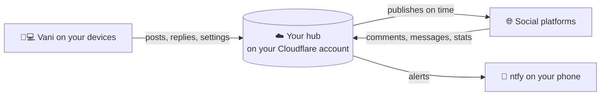

<h1 align="center">
  <br>
  <a href="https://github.com/sudharamachandranrajeev/vani"></a>
  <br>
  Vani
  <br>
</h1>

<h4 align="center">Post, schedule and answer across your social media accounts from one app, with alerts for what you are looking for.</h4>

<p align="center">
  <a href="https://github.com/sudharamachandranrajeev/vani/releases"></a>
  
  
  <a href="https://github.com/sudharamachandranrajeev/brahma"></a>
</p>

<p align="center">
  <a href="#-what-it-does">What it does</a> •
  <a href="#-get-started">Get started</a> •
  <a href="#-how-it-works">How it works</a> •
  <a href="#-faq-and-troubleshooting">FAQ</a> •
  <a href="#%EF%B8%8F-for-developers">For developers</a>
</p>

<p align="center">
  
</p>

Vani ("voice") is a social media manager for people who run their own accounts, a small business
or a client's pages. It covers Instagram, Facebook, YouTube, LinkedIn, Threads, Bluesky, Mastodon and
Telegram. The posting and listening run on your own small server (the **hub**), on a free Cloudflare
account, so nothing depends on a Vani company.

> [!WARNING]
> Vani is an **early test**. It is built and tested against a simulated hub with made-up data, but
> not yet against real accounts on every platform. Expect some posts or sign-ins to fail, and keep
> each platform's own app at hand.

## ✨ What it does

- 🏠 **Everything at a glance** – followers, views, new replies, account health, top posts and what
  is up next.
- ✍️ **Write once, post everywhere** – one post to many accounts, with wording and format per
  account, live character counts, image descriptions (alt text) and a media library.
- 📅 **Schedule and plan** – post now, at a set time, or into a weekly queue. Drag a post on the
  **Calendar** to move it.
- 📥 **One inbox** – comments, replies, direct messages, mentions and live chat in one place, with
  saved replies and bulk actions.
- 🤖 **AI help** (optional) – captions and hashtags, suggested replies, mood and priority tags,
  translation both ways, and a short summary of your week every Monday.
- 🔔 **Alerts** – describe what you want in plain words ("blue studio pottery under £50") and Vani
  drafts a watch over marketplaces and social platforms. Matches arrive on your phone.
- 🛡️ **Moderation** – hide or delete comments where the platform allows it.
- 👥 **Profiles** – keep your own accounts, a business and a client apart, each with its own posts,
  inbox and alerts.
- 📊 **Analytics** – follower growth, best times to post and top content. ...and more.

## 📸 Screenshots

<table>
  <tr>
    <td align="center"><br><sub>Home</sub></td>
    <td align="center"><br><sub>Inbox with AI tags</sub></td>
    <td align="center"><br><sub>Calendar (light)</sub></td>
  </tr>
  <tr>
    <td align="center"><br><sub>Create a post</sub></td>
    <td align="center"><br><sub>Analytics</sub></td>
    <td align="center"><br><sub>Inbox on desktop</sub></td>
  </tr>
</table>

<sub>All screenshots show a made-up studio's accounts, rendered from the current code.</sub>

## 🚀 Get started

> [!NOTE]
> **Use Vani inside [Brahma](https://github.com/sudharamachandranrajeev/brahma/releases) for now.**
> The standalone Vani 0.2.0 download expects an older hub that has since moved, so it cannot be
> set up from scratch today. Brahma 0.3.1 already has the guided hub setup below. The next Vani
> release brings it to the standalone app.

### Step 1 – Download

Download **Brahma** from its [releases page](https://github.com/sudharamachandranrajeev/brahma/releases)
and install it (its page has the steps). Vani is the red card on its home screen.

The standalone Vani files are on the [Vani releases page](https://github.com/sudharamachandranrajeev/vani/releases):

| Your device | File to download | Works on |
| --- | --- | --- |
| 🐧 Linux computer | `Vani-<version>-linux-x64.tar.gz` | Ubuntu 24.04, Fedora, Arch and similar (64-bit x86) |
| 🪟 Windows computer | `Vani-<version>-windows-x64-setup.exe` | Windows 10 and 11 |
| 🤖 Android phone | `Vani-<version>-android.apk` | Android 7 and newer |

<details>
<summary><b>Installing the standalone app</b></summary>

- **Linux**: unpack the file, then run `./install.sh` in its folder as your normal user. To remove it,
  run `./install.sh --uninstall`. Your data stays. Vani needs a running keyring (GNOME Keyring or
  KWallet).
- **Windows**: run the setup file. If Windows says *"Windows protected your PC"*, click **More info →
  Run anyway**. It appears because the app isn't paid-signed yet.
- **Android**: open the `.apk` and allow installs from your browser or file manager if asked.

</details>

### Step 2 – Make your hub (once, on a computer)

The hub is the part that posts and listens while your devices are off. Make it on a Windows or Linux
computer. It takes about 15 minutes and costs nothing.

1. Open Vani, then **Settings → Social hub → Set up a hub**.
2. Follow the steps: create a free Cloudflare account, switch on R2 (Cloudflare's file storage, for
   your images and videos), and make a key. Each step has a button that opens the right page.
3. Vani builds the hub on your account and shows two QR codes.
4. For alerts, install the free [ntfy](https://ntfy.sh) app on your phone and scan the second code.
   Then tap **Send a test alert**.

### Step 3 – Connect your accounts

1. Open **Accounts**.
2. **Bluesky, Mastodon and Telegram** connect straight away: sign in, or give a bot or app password.
3. **Facebook & Instagram, Threads, YouTube and LinkedIn** need a free developer app of your own.
   Vani shows each step, the exact addresses to paste and a **Copy** button, then **Sign in**.

### Step 4 – Add your phone

- **With Brahma sync on**, the phone picks up the hub by itself. The hub's link travels in your
  encrypted sync.
- **Without sync**, open **Settings → Social hub → Phone link** on the computer. With the standalone
  Vani app, scan the code with the phone's camera. Inside Brahma, copy the link, send it to
  yourself, and paste it into **Connect hub** on the phone.

### Step 5 (optional) – Turn on AI

Open **Settings → AI** and add a key for Anthropic, OpenAI, Google Gemini (free tier) or
OpenRouter. On a computer you can use your own Claude, ChatGPT or Gemini plan instead, through its
official command-line app, while Vani is open.

## 🧭 How it works



- **Your hub does the work** while your devices are off: it publishes on schedule, collects the
  inbox, runs your alerts and pushes them to your phone.
- **The hub holds your platform sign-ins**, locked (encrypted) with a secret only your hub knows.
  It runs on your own Cloudflare account, not a shared service.
- **Your devices share the hub's address and key** through Brahma's end-to-end encrypted sync, if
  you turn sync on.
- **AI requests** go only to the AI service you chose, and only when you use an AI feature.

> [!IMPORTANT]
> The hub's link (address and key) opens every profile on it. Share it only with your own devices,
> and never post the QR code.

## ❓ FAQ and troubleshooting

<details>
<summary><b>Does it cost anything?</b></summary>

Cloudflare's free plan covers a hub for a person or small business. AI is optional; with a paid AI
key, you pay that provider for what you use.
</details>

<details>
<summary><b>Why do Facebook, Instagram, YouTube and LinkedIn need a developer app?</b></summary>

Those platforms only let approved apps post for you. With your own free developer app, your
sign-ins never pass through anyone else's servers. Vani walks you through it, about 10 minutes each.
</details>

<details>
<summary><b>Can I make the hub from my phone?</b></summary>

No. Make it once on a Windows or Linux computer, then connect the phone as in Step 4.
</details>

<details>
<summary><b>Are profiles private from each other?</b></summary>

They keep things tidy, not secret. Anyone with the hub's link can open every profile.
</details>

<details>
<summary><b>Windows says the app might be unsafe</b></summary>

The build isn't code-signed (a paid certificate). Click **More info → Run anyway**. Check the file
against `SHA256SUMS.txt` on the release if you want to be sure it is genuine.
</details>

<details>
<summary><b>Where is my data stored?</b></summary>

Posts, the inbox and media live on your hub. On Linux, Vani's own settings are encrypted in
`~/.local/share/dev.brahma.vani`, with the key in the desktop keyring.
</details>

## 🛠️ For developers

<details>
<summary>Build from source, test and release</summary>

You need [Git](https://git-scm.com), [Flutter](https://flutter.dev) 3.47 and, for the hub,
Node.js 24 or newer.

```bash
git clone https://github.com/sudharamachandranrajeev/vani
cd vani
flutter pub get
flutter run -d linux        # or windows, or an Android device

flutter analyze && flutter test                               # whole app against a fake hub
VANI_SHOTS=/tmp/vani-shots flutter test test/screenshots_test.dart   # render the screenshots
scripts/make-icons.sh                                         # icons from branding/vani.svg
(cd hub && npm ci && npm test && npm run bundle)              # rebuild the hub into assets/hub
```

- The tests run the app against an in-memory fake hub (`test/fake_hub.dart`). Nothing leaves the
  machine.
- Vani ships the hub's code in `assets/hub`. After changing `hub/`, bump `hub/src/version.ts` and
  rebuild it. The hub's API, schedule and profiles are in [hub/README.md](hub/README.md).
- A `v*` tag builds, smoke-tests and publishes the Android, Windows and Linux builds
  (`.github/workflows/release.yml`). Changes per version: [CHANGELOG.md](CHANGELOG.md).

</details>

<details>
<summary>Credits</summary>

- [Flutter](https://flutter.dev) and [Riverpod](https://riverpod.dev)
- [drift](https://drift.simonbinder.eu), [http](https://pub.dev/packages/http),
  [intl](https://pub.dev/packages/intl), [file_picker](https://pub.dev/packages/file_picker),
  [url_launcher](https://pub.dev/packages/url_launcher)
- [Font Awesome Flutter](https://pub.dev/packages/font_awesome_flutter) for platform brand icons
- [Inter](https://rsms.me/inter/) and [Plus Jakarta Sans](https://github.com/tokotype/PlusJakartaSans)
  fonts (SIL Open Font License)
- [ntfy](https://ntfy.sh) for phone alerts

</details>

## Related

Vani is one app in the **Brahma** family. They share one sign-in and one sync server.

| App | What it does |
| --- | --- |
| [brahma](https://github.com/sudharamachandranrajeev/brahma) | The shared core and the all-in-one app |
| [artha](https://github.com/sudharamachandranrajeev/artha) | Money: accounts, spending, bills and investments |
| [graha-anveshana](https://github.com/sudharamachandranrajeev/graha-anveshana) | Find a home to rent or buy |
| [vahana-anveshana](https://github.com/sudharamachandranrajeev/vahana-anveshana) | Find a car |
| [udyoga](https://github.com/sudharamachandranrajeev/udyoga) | Career and job hunting |
| [vidya](https://github.com/sudharamachandranrajeev/vidya) | Learning, flashcards and focus |
| [bhojana](https://github.com/sudharamachandranrajeev/bhojana) | Shopping lists priced across UK shops |

## License

No licence has been chosen yet; all rights reserved.

---

> GitHub [@sudharamachandranrajeev](https://github.com/sudharamachandranrajeev)
